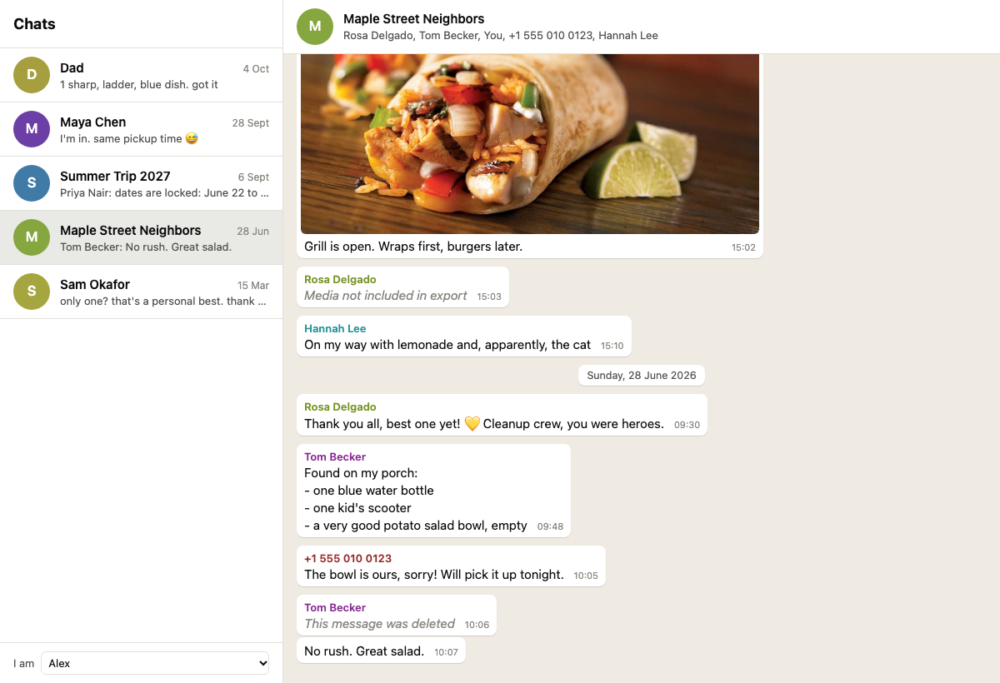

# WhatsApp chat viewer

A single HTML file for reading exported WhatsApp chats in the browser, with photos, videos,
voice notes, and documents shown inline.



## Why this exists

WhatsApp can move your chat history from Android to an iPhone only through the Move to iOS
app, and that app runs only while an iPhone is being set up. If the iPhone is already in use,
the transfer requires a factory reset first.

This viewer is the second-best option: export the chats you care about from the Android
phone, keep them in a folder, and read them here. The history does not end up inside WhatsApp
on the new phone, but it stays readable and searchable with the browser's find function.

The drawback is that WhatsApp has no bulk export. Every chat has to be exported by hand, one
at a time.

## Exporting a chat

On the Android phone, for each chat:

1. Open the chat.
2. Tap the three-dot menu, then **More**, then **Export chat**.
3. Choose **Include media**.
4. Save or send the result somewhere you can reach from your computer.

WhatsApp limits an export to the most recent 10,000 messages with media, or 100,000 without.

Each export is a folder (or a zip file, which you need to unzip) named
`WhatsApp Chat with <name>`. It contains a `.txt` file with the messages and the attached
media files.

## Using the viewer

There are two ways to load chats. Picking a folder is the simpler one.

### Pick a folder

1. Open `index.html` in a desktop browser. Double-clicking a downloaded copy works, and so
   does a copy hosted on a website.
2. Click **Choose folder** and select the folder that holds your exported chat folders, or
   drag that folder onto the page.

The files are read by the browser on your device and are not uploaded. You can select a
folder with many chats in it or a single chat folder:

```
my-chats/                                  <- choose this folder
├── WhatsApp Chat with Maya Chen/
│   ├── WhatsApp Chat with Maya Chen.txt
│   ├── IMG-20260815-WA0000.jpg
│   └── ...
└── WhatsApp Chat with Summer Trip 2027/
    └── ...
```

Browser differences:

- **Chrome and Edge** remember the folder. On the next visit, a **Reopen** button loads it
  again after one permission click.
- **Firefox and Safari** need the folder picked again on each visit. Their folder dialog
  uses the word "upload", which is the browser's standard wording for any file selection.
  Nothing is sent anywhere.
- **Phones** have poor support for selecting folders, so this is a desktop feature.

### Serve a folder

If you prefer a fixed setup that loads without picking anything, put the exported chat
folders in a subfolder next to `index.html` and start a static file server:

```
my-viewer/
├── index.html
└── chats/
    ├── WhatsApp Chat with Maya Chen/
    └── WhatsApp Chat with Summer Trip 2027/
```

```sh
cd my-viewer
npx serve -l tcp://127.0.0.1:3000
```

Open <http://localhost:3000/?dir=chats>. The page reads the server's listing of that
subfolder and shows every chat folder it finds.

- **Keep the server local.** The `-l tcp://127.0.0.1:3000` part keeps the server reachable
  from your own computer only. A plain `npx serve` listens on all network interfaces, so
  other devices on the same network could open your chats.
- **Use a subfolder.** The chats cannot sit directly beside `index.html`, because a server
  shows `index.html` in place of that folder's listing. The exception is a folder with a
  `manifest.json`, described under "Hosting a copy".

Any static server that renders folder listings as links works, for example
`python3 -m http.server --bind 127.0.0.1 3000`.

## Hosting a copy

`index.html` can be put on any static host, such as GitHub Pages. Visitors load their own
chats with **Choose folder**, and their files stay on their device.

Chats that live on the host itself, like the samples here, need one extra file. Hosts such as
GitHub Pages do not produce folder listings, so the page looks for a `manifest.json` that
names each chat folder and its files:

```json
{
  "chats": {
    "WhatsApp Chat with Maya Chen": [
      "WhatsApp Chat with Maya Chen.txt",
      "IMG-20260815-WA0000.jpg"
    ]
  }
}
```

`samples/manifest.json` is the manifest for the sample chats.

## Trying it with the sample chats

The `samples` folder holds five fictional chats (three one-to-one and two groups) with photos,
a video, voice notes, PDFs, and polls. To see them:

- open `index.html`, click **Choose folder**, and select `samples`, or
- on a served or hosted copy, add `?dir=samples` to the address. The start screen has a
  **View sample chats** button for it when the folder is present.

## What it shows

- A chat list sorted by most recent message, with a preview of the last one.
- Messages as bubbles, grouped by day, with sender names in group chats.
- Images inline (click to enlarge), videos and voice notes with players, and other files as
  links that open in a new tab.
- Polls with their vote counts.
- System messages such as group creation and members being added.
- WhatsApp text formatting (`*bold*`, `_italic_`, `~strikethrough~`) and clickable links.
- Notes in place of deleted messages and of media that was not part of the export.
- Light and dark mode, following the system setting, and a single-column layout on phones.

## Privacy

The page is self-contained and loads no external scripts, fonts, or stylesheets. Chats from a
picked folder are read in the browser and are never sent over the network.

This is enforced by the browser as well as promised here: the page carries a
Content-Security-Policy that allows requests only to the server the page itself came from, so
it cannot contact any other server. Links inside messages go to their real websites when you
click them.

## Limitations

- **Whose phone it was.** An export does not record who exported it. The viewer assumes you are
  the sender who appears in the most chats, and the **I am** menu at the bottom of the chat
  list changes that. The choice is remembered in the browser.
- **Date order.** Exports write dates in the phone's locale. The viewer reads slash-separated
  dates as month/day/year unless a chat contains a first number above 12, in which case it
  reads day/month/year.
- **Language.** Attachments are recognized in any export language as long as the file is
  present. Notes for deleted messages, omitted media, edits, and polls are recognized only in
  English exports, and appear as plain text otherwise.
- **iPhone exports.** The parser also accepts the bracketed format that WhatsApp on iPhone
  writes, but this has only been tested with Android exports.
- **Missing media.** Even with **Include media** chosen, WhatsApp writes `<Media omitted>` for
  anything it cannot attach, and the viewer shows a note in its place. WhatsApp does not
  document the rules, but the usual causes are: the file is no longer on the phone (deleted
  from storage, or never downloaded), the item was a view-once photo or video, or the chat has
  more media than one export carries, in which case older items are dropped first.
- **What an export leaves out.** Reactions, replies, and read receipts are not in the
  exported text, so they cannot be shown.

## Development

`tests/smoke.cjs` loads the sample chats through a local server and through the folder
picker, and checks what gets rendered. It needs Chrome and `puppeteer-core`:

```sh
npm install --no-save puppeteer-core
node tests/smoke.cjs
```

## License

The viewer is released under the GNU General Public License, version 3. See
[LICENSE](LICENSE). The sample photos are not covered by it; they remain under the Pexels
license.

## Credits

Sample photos are from [Pexels](https://www.pexels.com). See
[samples/CREDITS.md](samples/CREDITS.md) for the source of each file.
